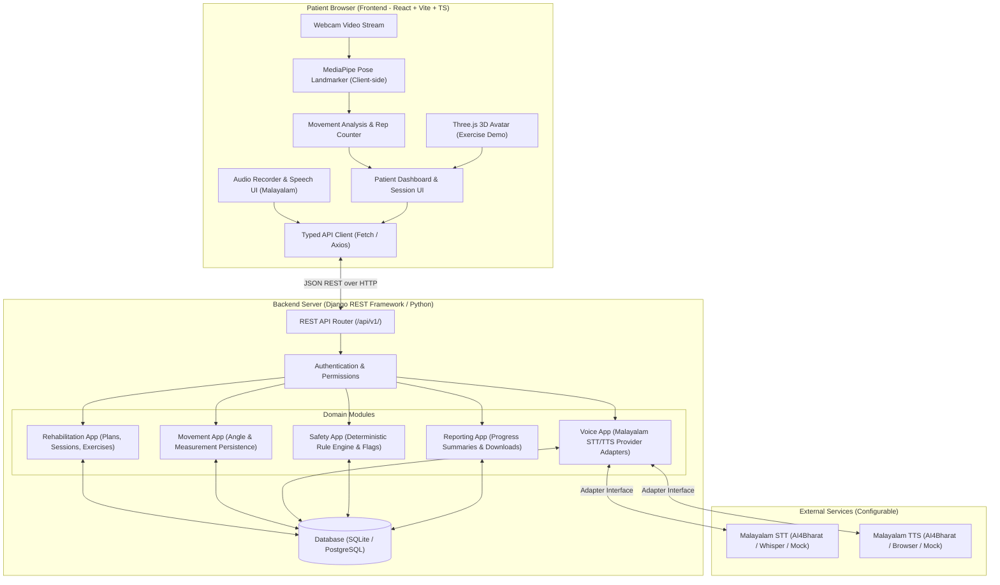

# RehabSense AI — Architecture and Technical Design

## 1. Executive Summary

**RehabSense AI** is a multimodal AI-powered physiotherapy companion designed to support home rehabilitation. It enables patients to perform prescribed physical therapy exercises with real-time pose tracking, visual 3D avatar guidance, repetition counting, and Malayalam voice interaction for symptom reporting. It also provides clinicians with structured session records, safety reviews, and progress tracking.

> [!IMPORTANT]
> **Clinical Disclaimer**: RehabSense AI is an assistive exercise companion and clinician review tool. It does **not** diagnose medical conditions, independently prescribe treatment, or replace a qualified healthcare professional. All exercise thresholds are configurable demonstration rules until validated by a licensed physiotherapist.

---

## 2. System Architecture Overview

---

## 3. Team Ownership and Module Boundaries

The architecture is divided into three decoupled domains for independent collaboration:

| Role | Owner | Core Responsibilities | Owned Paths |
|---|---|---|---|
| **Member 1** | Frontend & 3D Avatar Lead | UI/UX, Three.js 3D Avatar, webcam preview overlay, session controls, instructions, Malayalam interaction components, history view | `frontend/src/features/avatar/`, `frontend/src/components/`, `frontend/src/app/` |
| **Member 2** | Computer Vision Lead | MediaPipe Pose integration, joint angle geometry, repetition state machines, reliability validation, movement result generation | `frontend/src/features/movement/`, `vision-contracts/` |
| **Member 3** | Backend & Safety Lead | Django REST API, database models, Malayalam voice adapters, symptom extraction, deterministic safety engine, clinician review, audit logs, reports | `backend/`, `docs/api-contracts.md` |

### Shared Boundaries & Contracts
- **Vision Contract**: `vision-contracts/schemas/movement-result.schema.json` defines the exact contract between Member 2's vision engine and Member 1's UI, as well as Member 3's measurement persistence endpoint.
- **API Contracts**: `docs/api-contracts.md` defines versioned REST endpoints (`/api/v1/`).
- **Data Model**: `docs/data-model.md` defines database relationships and constraints.

---

## 4. Multi-modal Data Flow

### A. Movement Tracking & Repetition Flow (Browser-Side)
1. **Camera Capture**: Frontend captures video frames from user's webcam (`HTMLVideoElement`).
2. **Pose Detection**: Client-side `@mediapipe/tasks-vision` processes frames and extracts 33 standard body landmarks.
3. **Geometry & Angle Calculation**: Member 2's movement engine computes joint angles (e.g. knee flexion for squats, shoulder elevation for arm raises).
4. **Reliability Check**: If any critical landmark visibility is below threshold (e.g. `< 0.65`), `measurement_reliable` is flagged as `false`.
5. **Repetition State Machine**: Advances through states (`RESTING` -> `INFLECTION` -> `COMPLETED`) only on reliable frames.
6. **Result Dispatch**: Structured `MovementResult` is rendered in UI overlay and batched/sent to `POST /api/v1/sessions/{id}/measurements/`.

### B. Malayalam Voice & Symptom Confirmation Flow
1. **Audio Recording**: User taps microphone button in session UI; browser records audio via `MediaRecorder`.
2. **Backend Submission**: Audio blob is posted to `POST /api/v1/voice/transcribe/`.
3. **Provider Adapter**: Backend voice service delegates to configured provider (Mock or AI4Bharat/Whisper), returning recognized Malayalam text: `കൈ ഉയർത്തുമ്പോൾ വേദന കൂടുന്നു`.
4. **Conservative Symptom Extraction**: NLP/rule extractor creates a draft report (`pain_score`, `difficulty`, `body_area`).
5. **Patient Confirmation**: Draft is presented to the user in the UI. User confirms or modifies the details before submitting to `POST /api/v1/sessions/{id}/symptoms/` (`patient_confirmed: true`).

### C. Safety & Clinician Review Flow
1. When measurements or symptoms are submitted, `SafetyEvaluator` triggers deterministic rules.
2. If pain increases, severe symptoms are reported, or measurements are flagged as repeatedly unreliable, a `ClinicianReviewFlag` is created.
3. UI immediately displays conservative guidance: *"Pause exercise and follow clinician's instructions."*
4. Clinician reviews flagged sessions on the dashboard, examines audit logs, and resolves the flag with a documented resolution reason.

---

## 5. Technology Stack Decisions

- **Frontend**: Vite + React 19 + TypeScript.
  - *3D Avatar*: Three.js / React Three Fiber canvas demonstrating exercise biomechanics.
  - *Pose Vision*: `@mediapipe/tasks-vision` running WebAssembly in browser.
  - *Styling*: Modern, clean responsive CSS.
- **Backend**: Python 3.13 + Django 5 + Django REST Framework.
  - *Database*: SQLite (local development / demo), PostgreSQL compatible via `DATABASE_URL`.
  - *CORS*: `django-cors-headers` for frontend-backend communication.
- **Testing**:
  - Frontend & Vision: Vitest / Node test runner.
  - Backend: Django test suite (`python manage.py test`).
- **Deployment & Monorepo**: Single Git repository with clear subdirectories and environment isolation.
