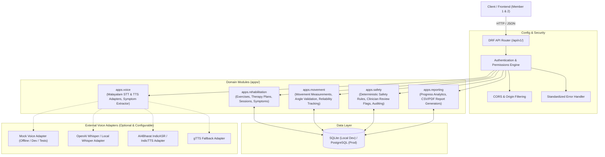

# RehabSense AI — Backend Architecture & Technical Specifications (Member 3)

## 1. System Overview & Role Definition

**RehabSense AI** is a multimodal AI-powered physical therapy companion designed for home exercise guidance. In our three-person hackathon team:
- **Member 1 (Frontend & 3D Avatar)**: Implements the React + TypeScript patient UI, Three.js 3D avatar visualization, and session dashboard.
- **Member 2 (Computer Vision)**: Implements client-side MediaPipe Pose Landmarker, joint-angle trigonometry, repetition counting state machines, and movement reliability evaluation.
- **Member 3 (Backend, Safety & Voice — This Module)**: Implements the Django REST Framework backend, database schema & migrations, session persistence, deterministic safety engine, clinician review workflow, Malayalam voice & symptom extraction adapters, progress aggregation, and downloadable clinical reports.

> [!IMPORTANT]
> **Clinical & Safety Guardrails**:
> RehabSense AI is an assistive rehabilitation prototype. It does **not** diagnose medical conditions, replace clinicians, independently prescribe treatments, or claim clinically validated accuracy. All angle thresholds and rules are demonstration parameters that must be approved by a licensed physiotherapist before clinical deployment.

---

## 2. Decoupled Backend Component Architecture

---

## 3. Technology Stack

- **Runtime**: Python 3.10+ (tested on Python 3.11.7)
- **Framework**: Django 5.x & Django REST Framework (DRF) 3.15+
- **Database**: SQLite for local hackathon development; database abstraction via Django ORM supports PostgreSQL with zero schema changes.
- **Cross-Origin Resource Sharing (CORS)**: `django-cors-headers` with environment-driven allowed origins.
- **Authentication**: Django's built-in authentication system with support for Token Authentication, Session Authentication, and flexible demo-mode headers (`X-Patient-Id`, `X-Clinician-Id`) for hackathon integration.
- **Audio & Media**: Built-in multipart parser, base64 audio responses, mime-type validation.
- **Reporting**: Python standard library `csv` module and structured JSON reporting.

---

## 4. Module Boundaries & App Organization

The backend is structured into five cohesive Django applications inside `backend/apps/`:

| Application | Purpose | Key Models / Services | Key Endpoints |
|---|---|---|---|
| `rehabilitation` | Exercise definitions, clinician therapy plans, exercise sessions, symptom records | `Exercise`, `TherapyPlan`, `TherapyPlanItem`, `RehabilitationSession`, `SymptomReport` | `/exercises/`, `/therapy-plans/`, `/sessions/`, `/sessions/{id}/symptoms/` |
| `movement` | Ingests and validates client-side MediaPipe movement results | `MovementMeasurement` | `/sessions/{id}/measurements/` |
| `safety` | Deterministic clinical rule evaluation, safety flags, and clinician sign-off audits | `ClinicianReviewFlag`, `ReviewResolutionAudit`, `evaluate_session_safety()` | `/safety/evaluate/` |
| `reporting` | Aggregates progress metrics and generates downloadable session reports | `ProgressSummaryView`, `ClinicianReviewListView`, `SessionReportView` | `/progress/`, `/clinician/reviews/`, `/sessions/{id}/report/` |
| `voice` | Provider-independent Malayalam speech-to-text, text-to-speech, and symptom parsing | `BaseSTTProvider`, `BaseTTSProvider`, `MalayalamSymptomExtractor`, `MockMalayalamVoiceAdapter` | `/voice/transcribe/`, `/voice/speak/` |

---

## 5. Domain Rules & Business Invariants

1. **Strict Canonical Exercise Identifiers**:
   Only two canonical exercise IDs are permitted across the entire system:
   - `bodyweight_squat`
   - `shoulder_flexion`
   Any request supplying an unapproved exercise ID is rejected with HTTP `400 Bad Request`.

2. **Therapy Plan Approval Invariant**:
   Only therapy plans explicitly approved by a clinician (`is_approved=True` / `approval_status='approved'`) can be assigned to active patient sessions. Unapproved plans remain drafts and cannot be presented as clinician-validated protocols.

3. **Session Ownership & Data Privacy**:
   Patients may only view, submit measurements to, and download reports for sessions belonging to their patient identity. Cross-patient data exposure is prevented at the query level. Ordinary patients cannot access clinician review queues.

4. **Reliability vs. Technique Separation**:
   Measurement reliability (e.g. low camera visibility, occlusion, lighting defects) is strictly decoupled from movement correctness or patient compliance. A patient is **never** penalized or scored as failing when camera tracking is unreliable.

5. **Deterministic Explainable Safety**:
   Safety decisions are 100% deterministic and rule-based. No non-deterministic LLM evaluates whether a session should be flagged or paused. Every flag records explicit machine-readable reason codes and clinician audit trails.

6. **Conservative Patient-First Guidance**:
   Whenever severe pain ($\ge 7/10$) or worsening pain is reported, the system immediately recommends pausing the exercise and consulting a clinician. If red-flag urgent symptoms are reported, the system advises immediate emergency medical assistance.

7. **Symptom Confirmation Safeguard**:
   Symptom data extracted from Malayalam speech or text is saved as unconfirmed draft until the patient reviews and explicitly confirms the parsed parameters. Unconfirmed drafts do not skew clinical progress trends.
