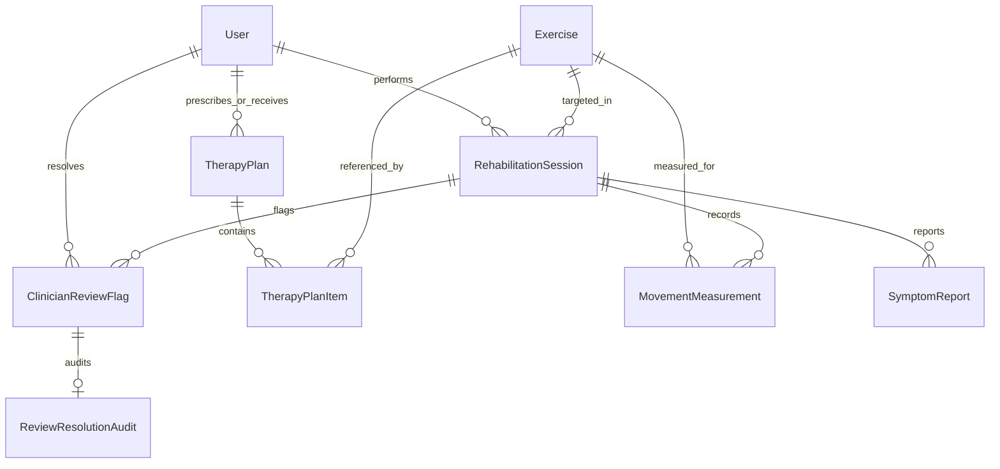

# RehabSense AI — Data Model and Database Schema

## 1. Entity-Relationship Overview

---

## 2. Table Definitions

### 2.1 `Exercise` (`apps.rehabilitation.Exercise`)
Stores canonical exercise definitions and baseline parameters.
- `id` (CharField, PK, 50): Canonical ID (`bodyweight_squat` or `shoulder_flexion`).
- `name` (CharField, 100): Human-readable exercise title.
- `description` (TextField): Clinical biomechanics overview.
- `instructions_en` (TextField): Patient instructions in English.
- `instructions_ml` (TextField): Patient instructions in Malayalam (മലയാളം).
- `target_joints` (JSONField, default=list): Tracked joint landmarks (e.g. `["left_knee", "right_knee"]`).
- `demo_parameters` (JSONField, default=dict): Configurable demonstration inflection & resting angle thresholds.
- `default_target_reps` (PositiveIntegerField, default=10): Baseline prescribed repetitions.
- `is_active` (BooleanField, default=True): Active status.
- `created_at` (DateTimeField, auto_now_add=True).

### 2.2 `TherapyPlan` (`apps.rehabilitation.TherapyPlan`)
Clinician-prescribed rehabilitation routine.
- `id` (UUIDField, PK, default=uuid4).
- `patient` (ForeignKey -> `auth.User`, null=True, blank=True, on_delete=SET_NULL).
- `patient_identifier` (CharField, 100, default='demo_patient'): Patient label for display.
- `clinician_name` (CharField, 100): Prescribing clinician.
- `instructions` (TextField, blank=True): Clinician notes and home exercise instructions.
- `diagnosis_notes` (TextField, blank=True): Clinical indication notes.
- `approval_status` (CharField, choices: `draft`, `approved`, `rejected`, default=`draft`).
- `is_approved` (BooleanField, default=False): Flag indicating whether the plan is clinician-approved.
- `approved_by` (ForeignKey -> `auth.User`, null=True, blank=True, on_delete=SET_NULL): Approving clinician.
- `approved_at` (DateTimeField, null=True, blank=True).
- `is_active` (BooleanField, default=True).
- `created_at` (DateTimeField, auto_now_add=True).
- `updated_at` (DateTimeField, auto_now=True).

> [!IMPORTANT]
> **Approval Constraint**: Only plans where `approval_status == 'approved'` (or `is_approved == True`) are exposed as approved plans to active sessions. Approvals are never fabricated.

### 2.3 `TherapyPlanItem` (`apps.rehabilitation.TherapyPlanItem`)
Individual exercise prescription within a therapy plan.
- `id` (UUIDField, PK, default=uuid4).
- `therapy_plan` (ForeignKey -> `TherapyPlan`, related_name=`items`, on_delete=CASCADE).
- `exercise` (ForeignKey -> `Exercise`, on_delete=CASCADE).
- `target_sets` (PositiveIntegerField, default=3).
- `target_reps` (PositiveIntegerField, default=10).
- `notes` (TextField, blank=True).

### 2.4 `RehabilitationSession` (`apps.rehabilitation.RehabilitationSession`)
A single exercise session performed by a patient.
- `id` (UUIDField, PK, default=uuid4).
- `user` (ForeignKey -> `auth.User`, null=True, blank=True, on_delete=SET_NULL).
- `patient_identifier` (CharField, 100, default='demo_patient').
- `therapy_plan` (ForeignKey -> `TherapyPlan`, null=True, blank=True, on_delete=SET_NULL).
- `exercise` (ForeignKey -> `Exercise`, on_delete=PROTECT, related_name='sessions').
- `status` (CharField, choices: `in_progress`, `completed`, `aborted`, default=`in_progress`).
- `target_reps` (PositiveIntegerField, default=10).
- `completed_reps` (PositiveIntegerField, default=0).
- `notes` (TextField, blank=True): Patient or clinician session notes.
- `started_at` (DateTimeField, auto_now_add=True).
- `ended_at` (DateTimeField, null=True, blank=True).
- `review_required` (BooleanField, default=False).
- `summary_metrics` (JSONField, default=dict).

### 2.5 `MovementMeasurement` (`apps.movement.MovementMeasurement`)
Periodic or repetition snapshot joint tracking records emitted by Member 2's vision module.
- `id` (UUIDField, PK, default=uuid4).
- `session` (ForeignKey -> `RehabilitationSession`, related_name=`measurements`, on_delete=CASCADE).
- `exercise` (CharField, 50, default='bodyweight_squat'): Canonical exercise identifier.
- `repetitions` (PositiveIntegerField, default=0): Verified repetition count.
- `joint_angles` (JSONField, default=dict): Degrees e.g. `{"left_knee": 85.0, "right_knee": 88.0}`.
- `visibility` (JSONField, default=dict): Landmark confidence scores e.g. `{"left_knee": 0.95}`.
- `measurement_reliable` (BooleanField, default=True): Tracking reliability.
- `movement_checks` (JSONField, default=list): Biomechanics feedback flags.
- `current_phase` (CharField, 30, default='idle'): State machine phase.
- `captured_at` (DateTimeField): Client capture timestamp.
- `created_at` (DateTimeField, auto_now_add=True): Server recorded timestamp.

### 2.6 `SymptomReport` (`apps.rehabilitation.SymptomReport`)
Patient-reported subjective symptoms captured via text or Malayalam speech recognition.
- `id` (UUIDField, PK, default=uuid4).
- `session` (ForeignKey -> `RehabilitationSession`, related_name=`symptoms`, on_delete=CASCADE).
- `user` (ForeignKey -> `auth.User`, null=True, blank=True, on_delete=SET_NULL).
- `reported_at` (DateTimeField, auto_now_add=True).
- `raw_transcript` (TextField): Exact patient utterance or typed statement.
- `language` (CharField, 10, default='ml').
- `pain_score` (PositiveSmallIntegerField, null=True, blank=True): 0 to 10 VAS scale.
- `difficulty` (CharField, 50, blank=True): e.g. `easy`, `moderate`, `hard`, `very_hard`.
- `body_area` (CharField, 100, blank=True): e.g. `shoulder`, `knee`, `arm`.
- `extraction_status` (CharField, 30, choices: `draft`, `confirmed`, `rejected`, default=`draft`).
- `patient_confirmed` (BooleanField, default=False): Patient explicit validation.
- `extraction_metadata` (JSONField, default=dict).

### 2.7 `ClinicianReviewFlag` (`apps.safety.ClinicianReviewFlag`)
Safety flag generated deterministically when safety criteria are triggered.
- `id` (UUIDField, PK, default=uuid4).
- `session` (ForeignKey -> `RehabilitationSession`, related_name=`review_flags`, on_delete=CASCADE).
- `created_at` (DateTimeField, auto_now_add=True).
- `status` (CharField, choices: `pending`, `in_review`, `resolved`, `dismissed`, default=`pending`).
- `severity` (CharField, choices: `routine`, `warning`, `urgent`, default=`warning`).
- `flag_reasons` (JSONField, default=list): Machine-readable reason codes.
- `safety_feedback` (JSONField, default=list): Explanations shown to user.
- `resolved_by` (ForeignKey -> `auth.User`, null=True, blank=True, on_delete=SET_NULL).
- `resolved_at` (DateTimeField, null=True, blank=True).

### 2.8 `ReviewResolutionAudit` (`apps.safety.ReviewResolutionAudit`)
Permanent audit trail of clinician investigation and resolution.
- `id` (UUIDField, PK, default=uuid4).
- `review_flag` (OneToOneField -> `ClinicianReviewFlag`, related_name=`resolution`, on_delete=CASCADE).
- `clinician_identifier` (CharField, 100): Clinician name or ID.
- `clinician` (ForeignKey -> `auth.User`, null=True, blank=True, on_delete=SET_NULL).
- `resolved_at` (DateTimeField, auto_now_add=True).
- `clinician_notes` (TextField): Mandatory explanation of resolution.
- `resolution_action` (CharField, 100): Action code e.g. `acknowledged_and_plan_adjusted`.
