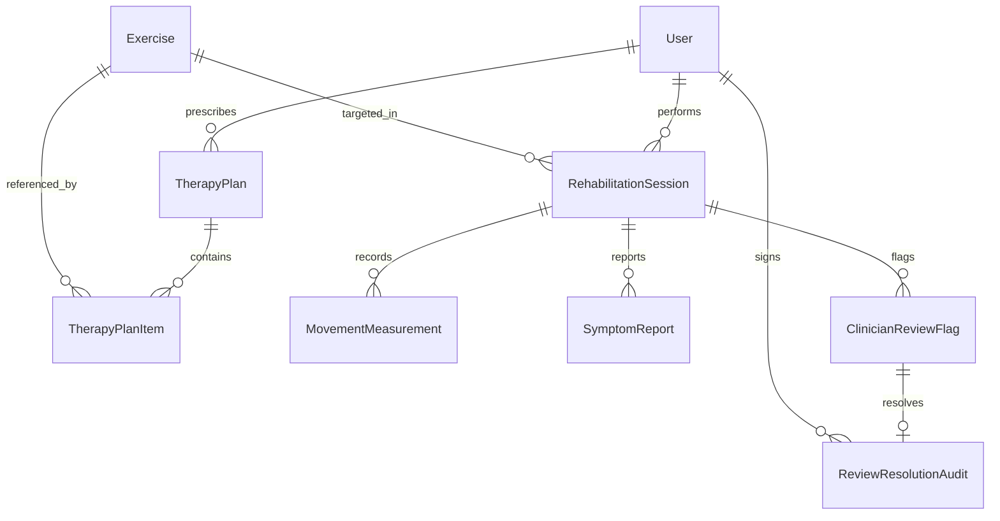

# RehabSense AI — Data Model and Database Schema

## 1. Entity-Relationship Overview

---

## 2. Table Definitions

### 2.1 `Exercise`
Stores canonical exercise definitions and baseline parameters.
- `id` (CharField, PK, e.g. `'bodyweight_squat'`, `'shoulder_flexion'`)
- `name` (CharField, 100)
- `description` (TextField)
- `instructions_en` (TextField)
- `instructions_ml` (TextField)
- `target_joints` (JSONField, e.g. `["left_knee", "right_knee"]`)
- `demo_parameters` (JSONField, e.g. `{"inflection_knee_angle": 100.0, "standing_knee_angle": 160.0}`)
- `is_active` (BooleanField, default=True)

### 2.2 `TherapyPlan`
Clinician-prescribed rehabilitation routine.
- `id` (UUIDField, PK)
- `patient_identifier` (CharField, 100)
- `clinician_name` (CharField, 100)
- `diagnosis_notes` (TextField, blank=True)
- `is_active` (BooleanField, default=True)
- `created_at` (DateTimeField, auto_now_add=True)
- `updated_at` (DateTimeField, auto_now=True)

### 2.3 `TherapyPlanItem`
Individual exercise prescription within a therapy plan.
- `id` (UUIDField, PK)
- `therapy_plan` (ForeignKey -> `TherapyPlan`, related_name=`items`)
- `exercise` (ForeignKey -> `Exercise`, on_delete=CASCADE)
- `target_sets` (PositiveIntegerField, default=3)
- `target_reps` (PositiveIntegerField, default=10)
- `notes` (TextField, blank=True)

### 2.4 `RehabilitationSession`
A single exercise session performed by a patient.
- `id` (UUIDField, PK, default=uuid4)
- `patient_identifier` (CharField, 100, default='demo_patient')
- `therapy_plan` (ForeignKey -> `TherapyPlan`, null=True, blank=True, on_delete=SET_NULL)
- `exercise` (ForeignKey -> `Exercise`, on_delete=PROTECT)
- `status` (CharField, choices: `in_progress`, `completed`, `aborted`, default=`in_progress`)
- `target_reps` (PositiveIntegerField, default=10)
- `completed_reps` (PositiveIntegerField, default=0)
- `started_at` (DateTimeField, auto_now_add=True)
- `ended_at` (DateTimeField, null=True, blank=True)
- `review_required` (BooleanField, default=False)
- `summary_metrics` (JSONField, default=dict) — stores aggregated stats like min/max angles, completion percentage.

### 2.5 `MovementMeasurement`
Periodic or snapshot joint tracking records emitted by the browser vision module.
- `id` (UUIDField, PK, default=uuid4)
- `session` (ForeignKey -> `RehabilitationSession`, related_name=`measurements`, on_delete=CASCADE)
- `captured_at` (DateTimeField)
- `repetitions` (PositiveIntegerField)
- `joint_angles` (JSONField, default=dict) — e.g. `{"left_knee": 85.0, "right_knee": 88.0}`
- `visibility` (JSONField, default=dict) — e.g. `{"left_knee": 0.95, "right_knee": 0.92}`
- `measurement_reliable` (BooleanField, default=True)
- `movement_checks` (JSONField, default=list) — e.g. `["low_visibility_knee"]`
- `created_at` (DateTimeField, auto_now_add=True)

### 2.6 `SymptomReport`
Patient-reported subjective symptoms captured via text or Malayalam speech recognition.
- `id` (UUIDField, PK, default=uuid4)
- `session` (ForeignKey -> `RehabilitationSession`, related_name=`symptoms`, on_delete=CASCADE)
- `reported_at` (DateTimeField, auto_now_add=True)
- `raw_transcript` (TextField)
- `language` (CharField, default='ml', max_length=10)
- `pain_score` (PositiveSmallIntegerField, null=True, blank=True) — scale 0-10
- `difficulty` (CharField, max_length=50, blank=True)
- `body_area` (CharField, max_length=100, blank=True)
- `patient_confirmed` (BooleanField, default=False) — explicitly confirmed by patient
- `extraction_metadata` (JSONField, default=dict)

### 2.7 `ClinicianReviewFlag`
Flag generated deterministically by the safety engine when safety criteria are triggered.
- `id` (UUIDField, PK, default=uuid4)
- `session` (ForeignKey -> `RehabilitationSession`, related_name=`review_flags`, on_delete=CASCADE)
- `created_at` (DateTimeField, auto_now_add=True)
- `status` (CharField, choices: `pending`, `in_review`, `resolved`, `dismissed`, default=`pending`)
- `severity` (CharField, choices: `routine`, `warning`, `urgent`, default=`warning`)
- `flag_reasons` (JSONField, default=list) — e.g. `["patient_reported_increasing_pain", "high_pain_score"]`
- `safety_feedback` (JSONField, default=list)

### 2.8 `ReviewResolutionAudit`
Audit record of clinician decision and sign-off.
- `id` (UUIDField, PK, default=uuid4)
- `review_flag` (OneToOneField -> `ClinicianReviewFlag`, related_name=`resolution`, on_delete=CASCADE)
- `clinician_identifier` (CharField, max_length=100)
- `resolved_at` (DateTimeField, auto_now_add=True)
- `clinician_notes` (TextField)
- `resolution_action` (CharField, max_length=100) — e.g. `'acknowledged_and_plan_adjusted'`, `'patient_contacted'`
