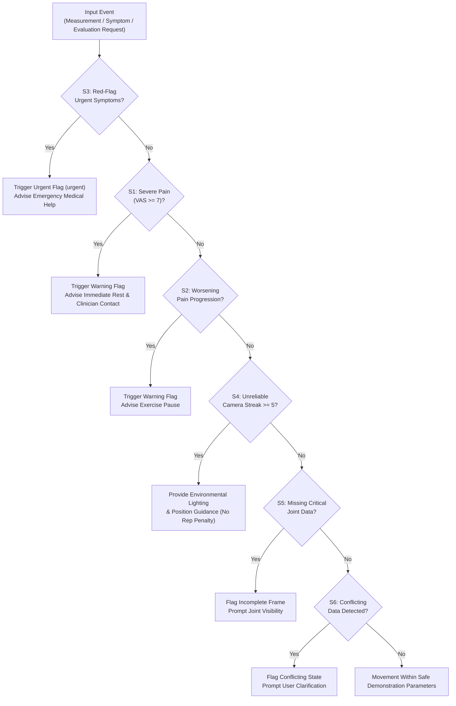

# RehabSense AI — Deterministic Safety Rules Engine Specification

## 1. Principles and Clinical Safeguards

1. **Conservative Action**: When symptoms worsen or severe discomfort is reported, the system advises immediately pausing the exercise. It **never** encourages pushing through pain.
2. **Deterministic & Explainable**: All safety decisions are calculated by explicit Python functions producing machine-readable reason codes and transparent user-facing explanations. No non-deterministic LLM makes medical safety calls.
3. **No Unvalidated Medical Diagnoses**: The system tracks kinematic parameters and symptom utterances; it does not diagnose pathologies (e.g. does not diagnose ligament tears or bursitis).
4. **Reliability Independence**: Occluded landmarks or low camera visibility are flagged as environmental/camera issues, **never** as bad technique or failed compliance.
5. **Flag Deduplication**: The engine checks whether an active pending flag with identical reasons already exists on the session before creating a new one, preventing notification fatigue.

---

## 2. Deterministic Rule Catalog



---

### Rule S1: Severe Pain (`high_pain_score`)
- **Trigger**: Patient-reported `pain_score >= 7` (on a 0–10 Visual Analog Scale).
- **Severity**: `warning`
- **Session State**: Sets `session.review_required = True`.
- **Reason Code**: `"high_pain_score"`
- **User Guidance**:
  - *English*: "High pain level reported. Please stop the exercise, rest, and notify your physiotherapist."
  - *Malayalam*: "കടുത്ത വേദന അനുഭവപ്പെടുന്നു. ദയവായി വ്യായാമം നിർത്തി വിശ്രമിക്കുക, ഫിസിയോതെറാപ്പിസ്റ്റിനെ അറിയിക്കുക."

---

### Rule S2: Worsening Pain Progression (`patient_reported_increasing_pain`)
- **Trigger**:
  - Explicit payload flag `worsening_pain == True`, OR
  - Malayalam text matching progression tokens (`കൂടുന്നു`, `കൂടുതൽ`, `കൂടി`), OR
  - English text matching progression tokens (`increasing`, `worsening`, `getting worse`), OR
  - Current pain score is $\ge 2$ points higher than the session baseline.
- **Severity**: `warning`
- **Session State**: Sets `session.review_required = True`.
- **Reason Code**: `"patient_reported_increasing_pain"`
- **User Guidance**:
  - *English*: "Your pain appears to be increasing. Pause the exercise and consult your clinician before resuming."
  - *Malayalam*: "വേദന കൂടുന്നതായി കാണുന്നു. വ്യായാമം താൽക്കാലികമായി നിർത്തി വിശ്രമിക്കുക."

---

### Rule S3: Red-Flag Urgent Medical Symptoms (`urgent_symptom_detected`)
- **Trigger**: Patient statement or symptom report contains urgent red-flag tokens:
  - *English*: `chest pain`, `shortness of breath`, `dizziness`, `faint`, `fainting`, `heart`, `numbness`, `emergency`
  - *Malayalam*: `നെഞ്ചുവേദന` (chest pain), `ശ്വാസതടസ്സം` (shortness of breath), `തലകറക്കം` (dizziness), `തളർച്ച` (faintness / sudden weakness), `ശ്വാസം`
- **Severity**: `urgent`
- **Session State**: Sets `session.review_required = True`, sets `urgent_alert = True`.
- **Reason Code**: `"urgent_symptom_detected"`
- **User Guidance**:
  - *English*: "URGENT: Serious symptom detected. Stop exercising immediately and seek immediate medical assistance."
  - *Malayalam*: "ശ്രദ്ധിക്കുക: അടിയന്തിര ലക്ഷണങ്ങൾ കാണുന്നു. ഉടൻ തന്നെ വ്യായാമം നിർത്തി വൈദ്യസഹായം തേടുക."

---

### Rule S4: Persistent Unreliable Tracking (`unreliable_camera_streak`)
- **Trigger**: $\ge 5$ consecutive measurement snapshots marked `measurement_reliable == False` or primary landmark visibility $< 0.65$.
- **Severity**: `routine`
- **Action**: Pause repetition counter advancement.
- **Reason Code**: `"unreliable_camera_streak"`
- **User Guidance**:
  - *English*: "Webcam tracking is currently unreliable. Please step back into full camera view and ensure proper room lighting."
  - *Malayalam*: "ക്യാമറയിൽ ശരീരം വ്യക്തമല്ല. വെളിച്ചം ഉറപ്പാക്കി ക്യാമറയ്ക്ക് നേരെ നിൽക്കുക."
- **Invariance**: Does **not** penalize the patient or count as failed repetitions.

---

### Rule S5: Missing Critical Measurements (`missing_critical_measurements`)
- **Trigger**: Required target joints for the exercise (e.g. `left_knee` for squats or `left_shoulder` for arm raise) are completely omitted or `null` in a reliable measurement submission.
- **Severity**: `routine`
- **Reason Code**: `"missing_critical_measurements"`
- **User Guidance**: "Target joints for this exercise are missing from tracking. Please adjust camera framing."

---

### Rule S6: Conflicting or Contradictory Data (`conflicting_data`)
- **Trigger**:
  - Patient reports `pain_score == 0` (no pain) but explicitly describes worsening sharp pain in transcript or flags `worsening_pain: true`.
  - Or patient reports `difficulty == "very_hard"` while pain is zero and repetitions are 0.
- **Severity**: `routine`
- **Reason Code**: `"conflicting_data"`
- **User Guidance**: "We noticed conflicting symptom details. Please clarify your current discomfort level."

---

### Rule S7: Unconfirmed Symptom Safeguard (`unconfirmed_symptom_draft`)
- **Trigger**: Symptom parsed from Malayalam STT where `patient_confirmed == False`.
- **Action**: Retained as draft; does not trigger permanent clinician review flags unless urgent tokens are present.
- **Reason Code**: `"unconfirmed_symptom_draft"`
- **User Guidance**: "Please review and confirm your extracted symptom details."

---

## 3. Flag Deduplication Policy

To prevent spamming the clinician review queue:
```python
existing_flag = ClinicianReviewFlag.objects.filter(
    session=session,
    status='pending',
    flag_reasons=reasons
).exists()
if not existing_flag:
    ClinicianReviewFlag.objects.create(...)
```
If an active pending flag with the exact reason codes already exists for the session, the engine skips duplicate flag creation while still returning the safety guidance to the client.
