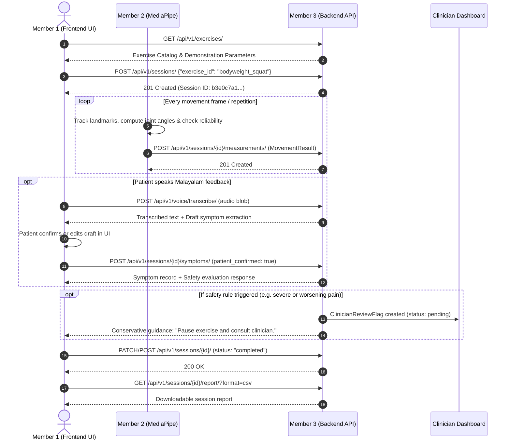

# RehabSense AI — Team Integration Contract & Guide (Members 1, 2 & 3)

## 1. Quick Integration Summary

This guide specifies the exact contracts, endpoints, schemas, and lifecycle rules connecting:
- **Member 1 (Frontend & 3D Avatar)**
- **Member 2 (Computer Vision & Repetition Tracking)**
- **Member 3 (Django REST Framework Backend & Safety — This Module)**

Base URL for all backend endpoints:
```
http://localhost:8000/api/v1/
```

---

## 2. Shared Canonical Constants

### 2.1 Canonical Exercise Identifiers
All modules must strictly use these exact snake_case strings:
- `bodyweight_squat`
- `shoulder_flexion`

*Do not use capitalized names, alternate spaces, or alternate slugs (e.g. `Squat`, `arm_raise`, `shoulder-flexion`). The backend will reject any other value with HTTP 400.*

### 2.2 Standard Units and Formats
| Metric | Format / Unit | Valid Range | Example |
|---|---|---|---|
| Joint Angles | Degrees (float) | `0.0` to `180.0` (or `360.0`) | `88.5` |
| Visibility / Confidence | Decimal (float) | `0.0` to `1.0` | `0.94` |
| Repetitions | Non-negative integer | $\ge 0$ | `8` |
| Timestamps | ISO-8601 UTC | `YYYY-MM-DDTHH:MM:SSZ` | `"2026-10-23T10:15:30Z"` |
| Pain Score | Integer (or null) | `0` to `10` | `6` |
| Session Status | Enum string | `in_progress`, `completed`, `aborted` | `"in_progress"` |

---

## 3. Session Lifecycle & State Machine



---

## 4. Key Endpoints & Payloads

### 4.1 Health Check
- **`GET /api/v1/health/`**
- Response:
```json
{
  "status": "healthy",
  "version": "1.0.0",
  "demo_mode": true,
  "voice_provider": "mock",
  "database": "connected"
}
```

### 4.2 Exercise Catalog
- **`GET /api/v1/exercises/`**
- Returns list of exercises with English and Malayalam instructions, target joints, and demo angles.

### 4.3 Create Session
- **`POST /api/v1/sessions/`**
- Body:
```json
{
  "exercise_id": "bodyweight_squat",
  "target_reps": 10,
  "therapy_plan_id": null
}
```
- Response: `201 Created` with session UUID and initial state.

### 4.4 Submit Movement Measurement (Member 2 Contract)
- **`POST /api/v1/sessions/{session_id}/measurements/`**
- Body matches `vision-contracts/schemas/movement-result.schema.json`:
```json
{
  "exercise": "bodyweight_squat",
  "repetitions": 5,
  "joint_angles": {
    "left_knee": 92.0,
    "right_knee": 94.5
  },
  "measurement_reliable": true,
  "visibility": {
    "left_knee": 0.95,
    "right_knee": 0.91
  },
  "movement_checks": [],
  "current_phase": "inflection",
  "captured_at": "2026-10-23T10:18:22Z"
}
```

> [!NOTE]
> **Reliability Semantics**:
> - If any critical landmark visibility is below threshold (e.g. `< 0.65`) or user steps out of frame, Member 2 sends `measurement_reliable: false` and adds `"low_visibility"` to `movement_checks`.
> - Unreliable measurements do **not** advance verified repetitions.
> - The backend stores the snapshot and tracks reliability independently from movement correctness.

### 4.5 Malayalam Voice & Symptoms
- **`POST /api/v1/voice/transcribe/`**: Audio upload or text fallback.
- **`POST /api/v1/voice/speak/`**: Text-to-speech audio synthesis.
- **`POST /api/v1/sessions/{session_id}/symptoms/`**: Submits confirmed symptom report.

### 4.6 Deterministic Safety Evaluation
- **`POST /api/v1/safety/evaluate/`**: Evaluates session safety state.

### 4.7 Progress & Clinician Review
- **`GET /api/v1/progress/`**: Aggregated patient progress summary.
- **`GET /api/v1/clinician/reviews/`**: Clinician flagged session queue.
- **`POST /api/v1/clinician/reviews/{review_id}/resolve/`**: Clinician resolution and audit.
- **`GET /api/v1/sessions/{session_id}/report/?format=csv`**: Downloadable session report.

---

## 5. Transitioning Frontend from Demo Mode to Live API

Member 1's `apiClient.ts` has built-in demo fallback mode:
1. In `frontend/.env`:
   ```bash
   VITE_API_BASE_URL=http://localhost:8000/api/v1
   VITE_DEMO_MODE=false
   ```
2. Start the backend: `python manage.py runserver 8000`
3. Frontend now makes live network calls to the Django backend.
4. If the backend is temporarily offline, setting `VITE_DEMO_MODE=true` allows frontend presentation without crashes.

---

## 6. Authentication & Permissions in Development vs Production

- **Development / Hackathon Mode (`DEMO_MODE=True`)**:
  - Open access enabled for health, exercise catalog, sessions, and demo patient operations.
  - Client can supply patient identity via header: `X-Patient-Id: Patient #1042`
  - Clinician endpoints verify clinician role or `X-Clinician-Id: Dr. Clinician`.
- **Production Mode (`DEMO_MODE=False`)**:
  - Enforces Django Token Authentication (`Authorization: Token <token>`) or Session Authentication.
  - Requires `is_staff=True` for clinician reviews and resolution.

---

## 7. Sample curl Commands for Quick Verification

### Health Check
```bash
curl -X GET http://localhost:8000/api/v1/health/
```

### Create a Session
```bash
curl -X POST http://localhost:8000/api/v1/sessions/ \
  -H "Content-Type: application/json" \
  -d "{\"exercise_id\": \"bodyweight_squat\", \"target_reps\": 10}"
```

### Submit Measurement
```bash
curl -X POST http://localhost:8000/api/v1/sessions/<SESSION_ID>/measurements/ \
  -H "Content-Type: application/json" \
  -d "{\"exercise\": \"bodyweight_squat\", \"repetitions\": 1, \"joint_angles\": {\"left_knee\": 90.0}, \"measurement_reliable\": true, \"visibility\": {\"left_knee\": 0.95}, \"movement_checks\": [], \"captured_at\": \"2026-10-23T10:00:00Z\"}"
```

### Evaluate Safety
```bash
curl -X POST http://localhost:8000/api/v1/safety/evaluate/ \
  -H "Content-Type: application/json" \
  -d "{\"session_id\": \"<SESSION_ID>\", \"pain_score\": 8, \"worsening_pain\": true}"
```
